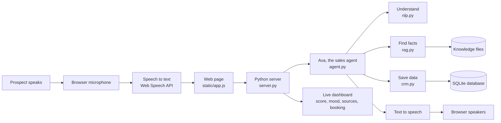
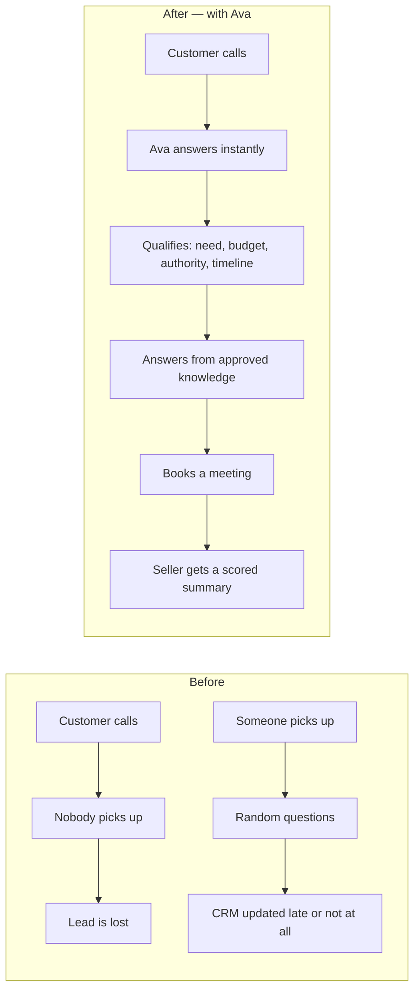
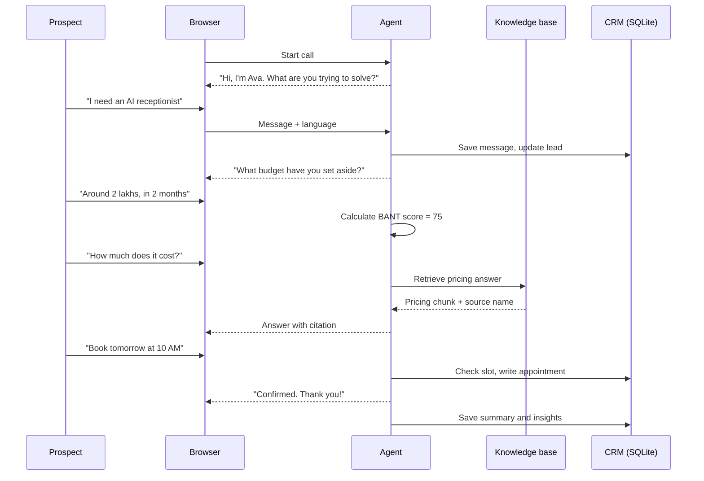
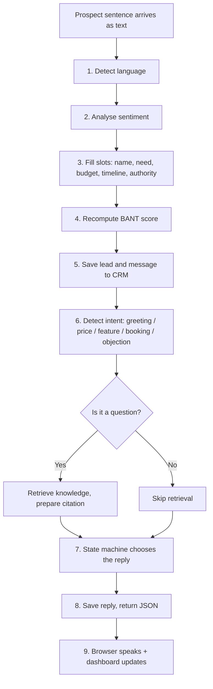
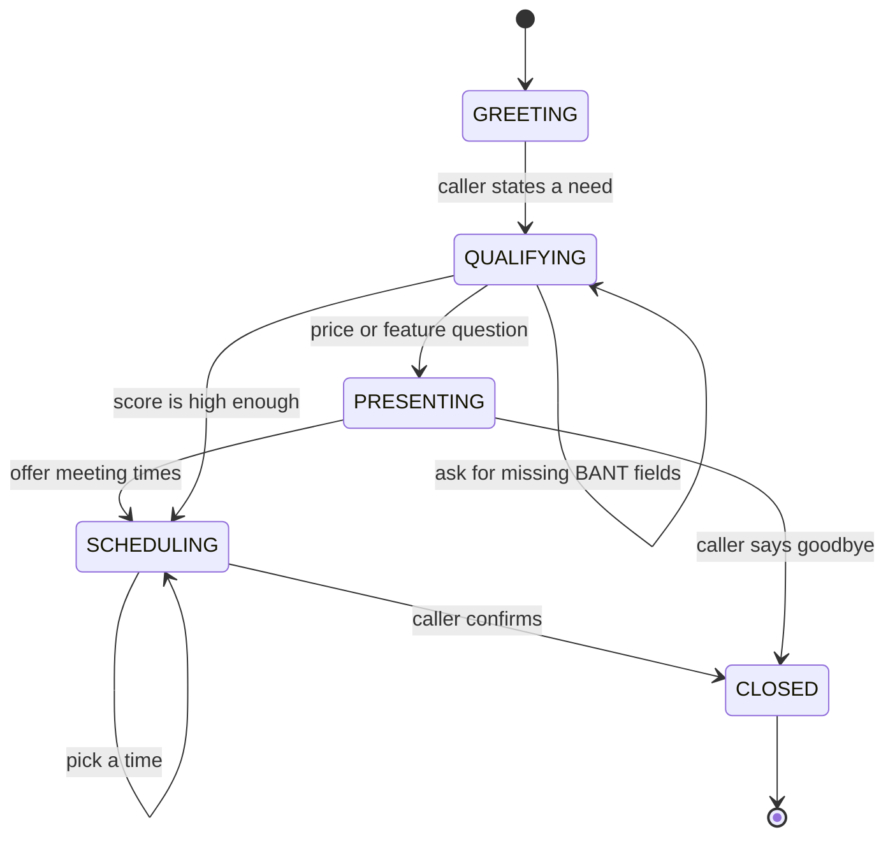
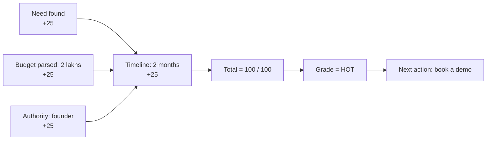
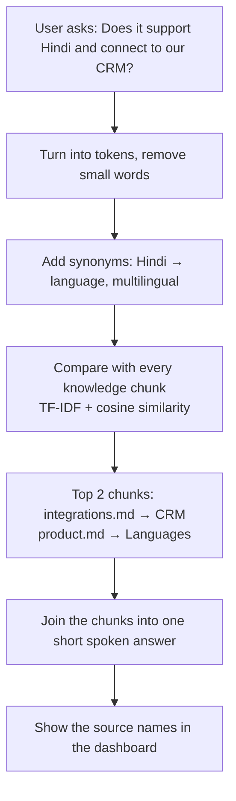
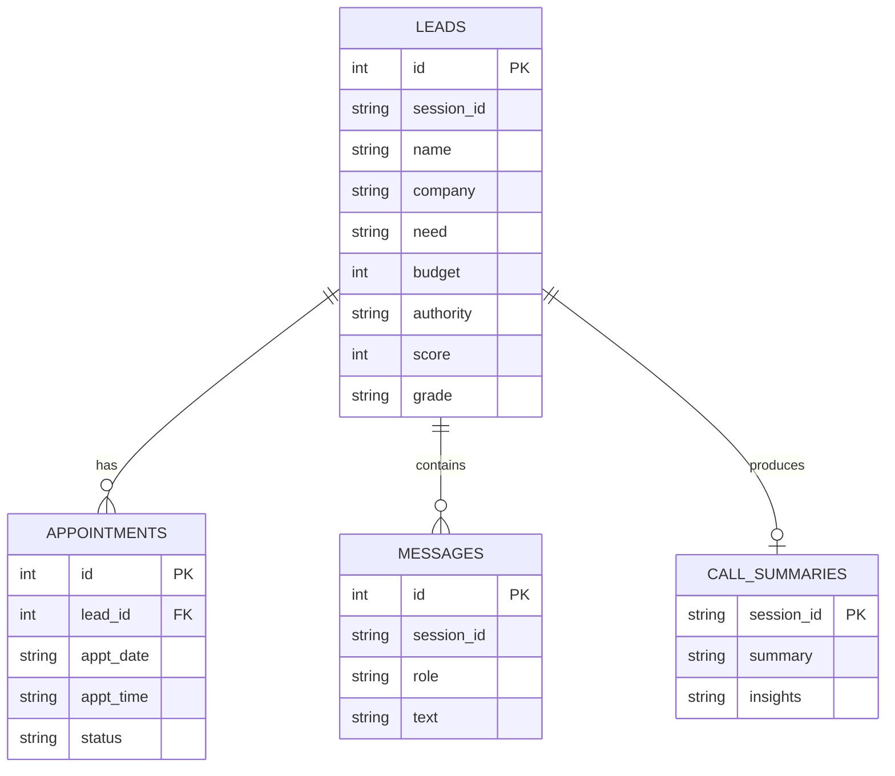
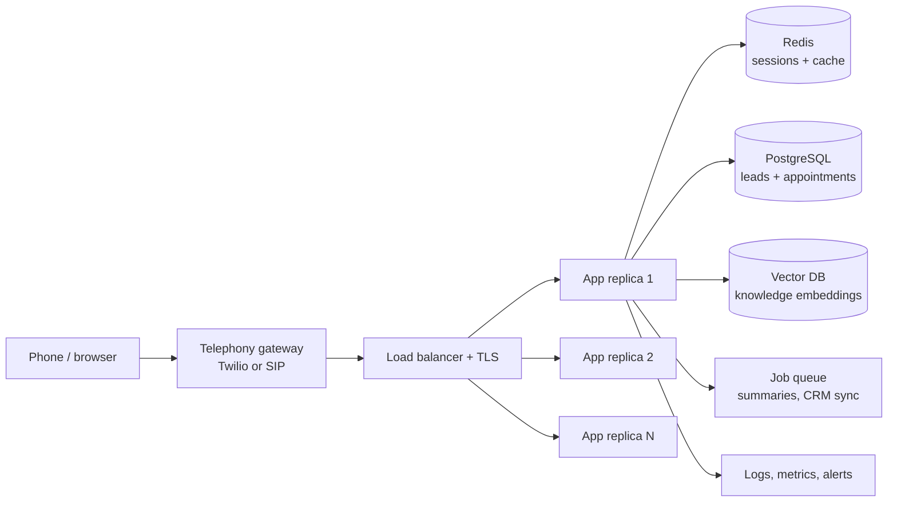
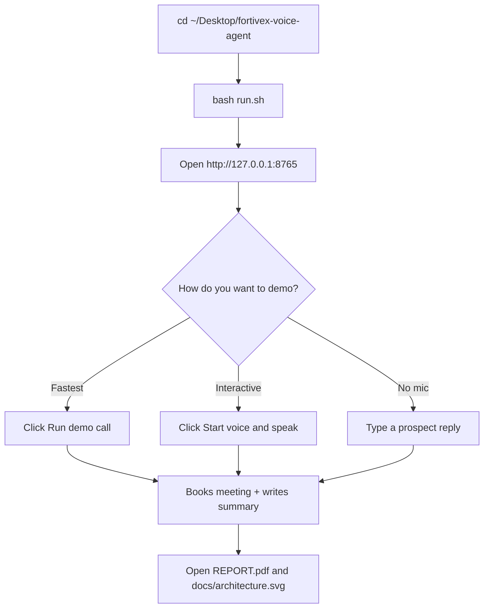

# Project diagrams — plain English

Every diagram below is Mermaid, so GitHub displays it automatically. Read them in order; together they explain the whole project.

---

## 1. The whole system in one picture

**In one line:** the browser turns speech into text, the agent decides what to say, and the browser turns the answer back into speech.

---

## 2. The business problem — before and after

**Why it matters:** no lead is wasted, every call is consistent, and the human seller starts with a brief instead of raw notes.

---

## 3. One call, step by step

---

## 4. What happens to a single message

**Key idea:** every step is small, visible and testable. Nothing is hidden inside a black box.

---

## 5. The conversation follows a simple state machine

**Why states?** The agent always knows what it should ask next, so it never loops or forgets a question.

---

## 6. Lead qualification — BANT scoring

| Field | Full points when… | Example from the demo |
|---|---|---|
| Budget | A number with currency or unit is spoken | "2 lakhs" → ₹200,000 |
| Authority | Caller says they decide | "I'm the founder" |
| Need | A use case is named | "AI receptionist" |
| Timeline | A period is spoken | "2 months" → 60 days |

70+ = HOT, 40–69 = WARM, below 40 = COLD.

---

## 7. How RAG answers a question

**Why RAG instead of hard-coded answers?** Facts live in `knowledge/*.md`. Change a price by editing one line; the agent never needs retraining, and every answer can be traced to a source.

---

## 8. Data model — what is stored

**Agenda check:** "contextual memory" = the MESSAGES table. "CRM integration" = the LEADS and APPOINTMENTS tables. A unique date+time check stops double bookings.

---

## 9. Scaling the same design to 1,00,000 users

**What changes, what stays:** the agent logic, BANT rules and conversation states stay exactly the same. Only the storage and speech layers are swapped for managed services. The app layer is stateless, so adding users means adding replicas.

---

## 10. How to run and present it

---

### Where each diagram lives in code

| Diagram | Code |
|---|---|
| Whole system | `voice_agent/server.py`, `agent.py` |
| Call steps | `voice_agent/agent.py` → `handle_message()` |
| State machine | `voice_agent/agent.py` → `_compose()` |
| BANT | `voice_agent/nlp.py` → `bant_score()` |
| RAG | `voice_agent/rag.py` → `KnowledgeBase` |
| Data | `voice_agent/crm.py` → `SCHEMA` |
| Scale | `REPORT.md` section 5 |
